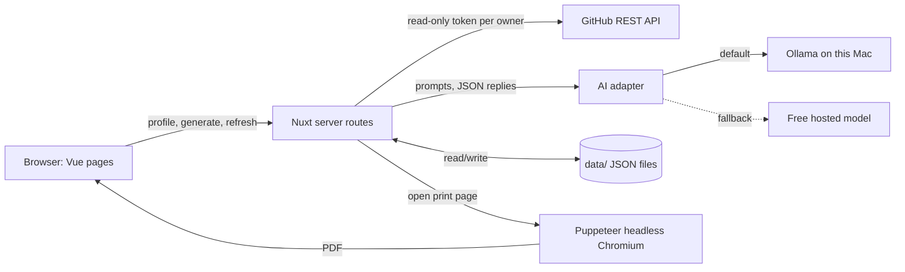

# TIYUHM (This Is Why You Hire Me) — Technical Spec

## How This Works, In Plain Language
TIYUHM is one Nuxt project (Nuxt is the full-stack framework for Vue) that does two jobs.

- **The pages** are Vue components: welcome, GitHub profile form, loading, owner picker, time period, Generate, and the resume. They all share one resume-shaped page look in your typewriter font and earthy palette.
- **The server part** is the same project, in a folder of server routes. It does the work the browser must never see: it reads your GitHub work with your tokens, asks an AI model which commits matter, writes the resume text, saves the resume to a file, and turns pages into PDFs.

Four ideas make it work:

1. **Owners.** Your work lives in several organizations plus your own account. Each place is an "owner." Each owner has its own read-only GitHub token, kept in a private config file that is never committed. The owner picker lists the owners from that file.
2. **The AI judge and writer.** The server sends your commits to a model in two passes. Pass 1 decides which commits are real work and which are noise (typo fixes and the like), reading the code change when the message is vague. Pass 2 writes short resume bullets for the real work, then the professional summary and skills. The model runs locally through **Ollama**, a program that runs open AI models on your Mac. Because every AI call goes through one small adapter, we can switch to a free hosted model without touching anything else.
3. **A saved resume.** The finished resume, a "last checked" timestamp and the AI's past verdicts go into JSON files in a `data/` folder. When you come back, the saved resume appears. The server then asks GitHub only for commits newer than the timestamp, runs just those through the AI, and adds any new bullets.
4. **PDFs from the same pages.** There is one plain "print" page. To download, the server opens it in a hidden browser (**Puppeteer**) and saves it as a PDF.

Why this shape and not something bigger: no login system, no database server, no background jobs and no live sync. Your PRD only needs the resume to be current when you return or refresh, and a file plus a check on page load does exactly that.

## The Core Journey Through the System
Implements `prd.md > The Core Journey`.

1. **Open the app** (`/`). The server checks for `data/resume.json`. If there's none, the welcome page shows TIYUHM and **Get started**. If there is one, you're sent straight to `/resume` (`prd.md > States and Boundaries`, returning use).
2. **Get started** reveals the profile form. You type a GitHub username.
3. **Submit.** The browser calls `POST /api/github/profile`. The server calls GitHub for that user and shows the loading screen meanwhile. If GitHub says "not found," you see the profile-not-found message. Otherwise the server reads `owners.config.json`, checks each owner's token works, and returns the profile and the list of owners (organizations plus "Personal projects").
4. **Pick owners.** You tick the ones to include. If none are accessible, you see the no-owners message.
5. **Pick a time period** (start date and end date). Generate unlocks only when at least one owner and both dates are set (`prd.md > Choosing organizations and time period`).
6. **Generate.** The browser calls `POST /api/resume/generate` and shows the loading state. The server:
   - fetches your authored commits and pull requests for each chosen owner in the date range,
   - drops merge commits, then batches the rest through **Pass 1** (triage),
   - sends the significant ones, grouped by owner, through **Pass 2** (bullets), then one more call for the summary and skills,
   - adds contact info from the GitHub profile and the demo education,
   - saves `data/resume.json` and the per-commit verdicts in `data/verdicts.json`.
   If nothing is significant, you see the no-meaningful-commits message.
7. **Resume page** (`/resume`) shows contact information, summary, experience, education and skills, plus two download buttons.
8. **Download.** A button calls `GET /api/pdf`. The server opens `/print/resume` in headless Chromium, saves the PDF, and sends it to the browser.
9. **Later.** You make a meaningful commit and reopen or refresh `/resume`. The page shows the saved resume at once and a small "checking for new work" note while it calls `POST /api/resume/refresh`. The server fetches commits since the last-checked time, runs only those through Pass 1 and, for significant ones, Pass 2, adds the bullets, updates the summary and skills, and saves. The page re-renders. A typo-level commit gets a "trivial" verdict and changes nothing (`prd.md > Automatic updates`).



## Stack
- **Nuxt** (current stable, with Vue 3 and TypeScript, which is Nuxt's default; version to be confirmed at build start). Docs: https://nuxt.com/docs. The learner chose Vue; Nuxt is its full-stack framework, so pages and server code live in one project. Tradeoff accepted: Nuxt adds conventions (folder-based routing, server versus browser code).
- **Your own CSS**, no component library. Docs: https://nuxt.com/docs/getting-started/assets. The learner chose this (not Quasar) so the typewriter, magazine look is not fighting Material Design defaults.
- **GitHub REST API** with read-only fine-grained tokens, called with plain `fetch` from server routes. Docs: https://docs.github.com/en/rest
- **Ollama**, with a local instruct model for the AI passes. Docs: https://github.com/ollama/ollama/blob/main/docs/api.md. The learner prefers local; the learner has an M-series Mac. The model is a build-start decision. I suggest trying an 8B-class instruct model (such as Llama 3.1 8B or Qwen 2.5 7B) and moving up if bullet quality is weak. Unverified: which model gives acceptable bullets and speed on this Mac; check early.
- **Hosted free-tier model (fallback only).** The adapter's second implementation will speak the common OpenAI-style chat format that several free tiers offer. No provider is chosen, and I could not confirm any free-tier terms today. Choose and verify only if Ollama fails.
- **Puppeteer** for the PDF. Docs: https://pptr.dev. The learner has not used it; accepted as "fine if it does the job." It downloads its own Chromium on install (about 150MB), which is fine for local running.
- **Fonts via Fontsource** (self-hosted font files in the project), so Puppeteer's PDFs render the typewriter font without internet. Docs: https://fontsource.org
- **Storage:** plain JSON files under `data/` (derived implementation detail; replaces SQLite from the conversation, because the saved data is one resume plus a lookup table and needs no queries).

## Where It Runs and How Someone Tries It
Runs locally on the learner's Mac. Requirements:
- Node.js (current LTS) and npm.
- Ollama installed and running, with the chosen model pulled (`ollama pull <model>`).
- `owners.config.json` filled in from `owners.config.example.json` (one entry per owner, each with its own **read-only** fine-grained token).
- `.env` file from `.env.example` (see External Services).

Start: `npm install`, then `npm run dev`, then open http://localhost:3000.

For the demo recording, show:
1. Welcome → Get started → profile → owners → dates → Generate → the resume.
2. The PDF downloading and opening.
3. A meaningful commit made in one of the repos, then a refresh that updates the resume. A typo commit changes nothing.

Reset to a first-run state by deleting the `data/` folder.

Submission needs the short demo video and a public GitHub repository. `owners.config.json`, `.env` and `data/` are gitignored, since they hold tokens and private commit summaries. Deployment is optional and not planned. If wanted later, the JSON-file storage and local Ollama would both need replacing, so recording locally is the plan.

## Look and Feel
Implements `prd.md > Look and Feel`. Direction: welcoming but professional, chic, modern and techie, a fashion magazine for tech, on a resume-shaped page in a typewriter face.

**Color roles** (proposal from the PRD's open item; learner to confirm at review):
| Role | Color |
|---|---|
| Page paper (resume sheet) | Almond Cream `#FFE8D6` |
| Surface behind the sheet | Desert Sand `#DDBEA9` |
| Body text, primary buttons (cream text on them) | Dusty Olive `#6B705C` |
| Accent: rules, section headings (large), highlights | Light Bronze `#CB997E` |
| Borders, dividers, disabled states | Ash Grey `#B7B7A4` |
| Quiet decoration, hover tints | Dry Sage `#A5A58D` |

Dusty Olive on Almond Cream is the only dark-on-light pairing, and its contrast is borderline for small text. Check it on screen at the build; use 16px or larger and bump the body weight if needed. Bronze and sage are for large or decorative use only, never small text.

**Typography:** a typewriter face, self-hosted via Fontsource. I suggest a typewriter-style display font for headings (for example Special Elite) and a readable monospace for body text (for example Courier Prime), both to be confirmed on screen at build. The learner owns the final pick.

**Layout:** every screen is a centered resume-shaped sheet (single column, generous margins, a thin bronze rule under section headings) on the sand surface. The resume page adds magazine touches: large masthead name, pull-quote-style summary, section kickers in small caps. Tone of copy: short, warm, a little witty ("Let's read your work.").

**PDF:** the print page reuses the on-screen resume look (palette and typewriter fonts). The separate plain "traditional" PDF was cut at build review.

## Components

### Pages (browser)
All pages share a `ResumeSheet` wrapper component for the one consistent look.

#### Welcome page (`pages/index.vue`)
Shows TIYUHM and **Get started**. On load, checks for a saved resume and redirects to `/resume` if one exists.
PRD ref: `prd.md > Getting started and connecting GitHub`, `prd.md > States and Boundaries`.

#### Setup flow (`pages/start.vue`)
One page that steps through profile form, profile loading screen, owner picker, time period, Generate and the generate loading state, plus the three error messages. Keeping it one page with a step variable avoids route juggling and keeps the typed profile, selected owners and dates in one place.
PRD ref: `prd.md > Getting started and connecting GitHub`, `prd.md > Choosing organizations and time period`, `prd.md > States and Boundaries`.

#### Resume page (`pages/resume.vue`)
Renders the saved resume (magazine style), the two download buttons, and the "checking for new work" refresh on load.
PRD ref: `prd.md > The generated resume`, `prd.md > Downloads`, `prd.md > Automatic updates`.

#### Print page (`pages/print/resume.vue`)
A bare page with no app chrome, used only by Puppeteer. It reads `data/resume.json` through the server and renders `ResumeBody`.
PRD ref: `prd.md > Downloads`.

### Server routes
#### GitHub profile route (`server/api/github/profile.post.ts`)
Fetches the user from GitHub, loads the owners config, verifies each token, returns the profile and the owner list.
PRD ref: `prd.md > Getting started and connecting GitHub`, `prd.md > States and Boundaries` (errors).

#### GitHub client (`server/utils/github.ts`)
All GitHub calls: user profile, repos per owner, authored commits in a date range, commit detail (files and truncated patch), authored pull requests. Pages through results. Reports 404 and token failures as typed errors.

#### Generate route (`server/api/resume/generate.post.ts`)
Runs the full pipeline from the Core Journey step 6 and saves the result.
PRD ref: `prd.md > The generated resume`.

#### Refresh route (`server/api/resume/refresh.post.ts`)
Runs the same pipeline for commits newer than `lastChecked` and merges results into the saved resume.
PRD ref: `prd.md > Automatic updates`.

#### Resume pipeline (`server/utils/pipeline.ts`)
The shared logic: fetch, prefilter, Pass 1, Pass 2, summary and skills, merge. Used by both generate and refresh so they cannot drift apart.

#### Prompts (`server/utils/prompts.ts`)
The Pass 1, Pass 2 and summary prompts, in one file. They are the heart of the product, and the learner writes and tunes them so the resume carries their voice (`learner-profile.md > Desired Learning Outcome`).

#### AI adapter (`server/utils/ai/index.ts`, `ollama.ts`, `hosted.ts`)
One function: `askJson(prompt, schema)`, which returns validated JSON. `ollama.ts` calls `POST http://localhost:11434/api/chat` with `stream: false` and the schema as `format`. `hosted.ts` is the fallback. The setting `AI_PROVIDER` in `.env` chooses between them.

#### PDF route (`server/api/pdf/[kind].get.ts`)
Launches Puppeteer, opens `/print/<kind>` on the running app, calls `page.pdf()` with print backgrounds on for the magazine version, returns the file with a download filename.
PRD ref: `prd.md > Downloads`.

#### Storage helper (`server/utils/store.ts`)
Reads and writes the JSON files in `data/`.

## Data Model
All stored as JSON under `data/`. Created on first Generate; deleting the folder resets the app.

**`data/resume.json`**, the saved resume. Survives restarts; shown on return.
- `profile`: `{ username, name, email?, location?, blog?, profileUrl }`, copied from GitHub at Generate time. Email is often empty on GitHub profiles; the resume then shows the GitHub profile URL instead.
- `selection`: `{ owners: [login...], from, to }`, kept so refreshes use the same owners.
- `summary`: string. Rewritten when a refresh adds bullets.
- `experience`: list of `{ ownerLabel, periodFrom, periodTo, bullets: [{ text, date, shas: [] }] }`, one group per owner. Each refresh appends new bullets to its owner's group and extends the period end. This is how updates add to the resume rather than rebuild it.
- `skills`: list of strings.
- `education`: demo data (flagged `isDemo: true` in the data, but shown without any demo label, per the learner's call at final review).
- `lastChecked`: ISO timestamp, moved forward after each successful generate or refresh.

**`data/verdicts.json`**, a lookup from commit SHA to `{ significant, oneLine }`. Stops a commit from being judged twice, and lets a refresh skip anything seen.

**`owners.config.json`** (gitignored, in the project root, not in `data/`): `[{ label, kind: "org" | "user", login, token }]`.

Where data lives, in the three questions: the resume is in `resume.json`; it's updated by generate and refresh; when you leave and return, the saved version shows first, then the refresh brings it up to date.

## File Structure
```
tiyuhm/
├── pages/
│   ├── index.vue                  # Welcome page; redirects if a resume is saved
│   ├── start.vue                  # Setup flow: profile, owners, dates, Generate, errors
│   ├── resume.vue                 # Magazine-style resume, downloads, refresh-on-load
│   └── print/
│       └── resume.vue             # Page Puppeteer prints for the PDF
├── components/
│   ├── ResumeSheet.vue            # The shared resume-shaped page wrapper
│   ├── ResumeBody.vue             # The five resume sections (shared by screen and prints)
│   └── StatusMessage.vue          # Loading and error messages
├── assets/css/
│   └── theme.css                  # Palette variables, typography, sheet look
├── server/
│   ├── api/
│   │   ├── github/profile.post.ts # Look up profile, list owners
│   │   ├── resume/index.get.ts    # Return the saved resume (or none)
│   │   ├── resume/generate.post.ts
│   │   ├── resume/refresh.post.ts
│   │   └── pdf/index.get.ts        # Puppeteer PDF of the resume
│   └── utils/
│       ├── github.ts              # GitHub REST calls
│       ├── pipeline.ts            # Fetch, triage, write, merge
│       ├── prompts.ts             # The AI prompts
│       ├── store.ts               # Read/write data/ JSON
│       ├── demoEducation.ts       # Placeholder education
│       └── ai/
│           ├── index.ts           # askJson() adapter entry
│           ├── ollama.ts          # Local model
│           └── hosted.ts          # Free-tier fallback
├── data/                          # Saved resume and verdicts (gitignored)
├── devpost/                       # Devpost learning workspace
├── nuxt.config.ts
├── owners.config.example.json     # Template, committed
├── owners.config.json             # Real tokens (gitignored)
├── .env.example                   # Template, committed
├── .env                           # Local settings (gitignored)
├── .gitignore
├── package.json
└── README.md                      # Setup and demo instructions
```

## External Services and Dependencies

### GitHub REST API
Docs: https://docs.github.com/en/rest. Auth: `Authorization: Bearer <token>` with the owner's token. Rate limit: 5,000 requests an hour with a token, plenty for one user. Cost: free. Calls (to be verified against the docs at build start):
- `GET /users/{username}` → name, email, blog, location, html_url (404 means profile not found).
- Repos: `GET /orgs/{org}/repos?type=all` for an org owner; `GET /user/repos?affiliation=owner` for the personal owner.
- Commits: `GET /repos/{owner}/{repo}/commits?author={username}&since=…&until=…`, paged.
- Commit detail: `GET /repos/{owner}/{repo}/commits/{sha}` → files and patch (truncated before sending to the AI).
- Pull requests: `GET /search/issues?q=type:pr author:{username} org:{org} created:{from}..{to}` (or `user:` for the personal owner).

**Token permissions: strictly read-only.** Create each as a fine-grained personal access token (https://docs.github.com/en/authentication/keeping-your-account-and-data-secure/managing-your-personal-access-tokens), with its resource owner set to that organization or account. Repository permissions: Contents (Read), Pull requests (Read), Metadata (Read). Grant no write permission of any kind, and select only the repos needed (or all repos of that owner). Classic tokens must not be used, because reaching private repos requires the write-capable `repo` scope. Some organizations require an admin to approve the token. Check early whether each organization allows it. The app never calls a GitHub write endpoint.

### Ollama (local AI)
Docs: https://github.com/ollama/ollama/blob/main/docs/api.md. Endpoint: `POST http://localhost:11434/api/chat` with `{ model, messages, stream: false, format: <JSON schema> }`. Reply content is JSON text, parsed and validated by the server. No key, no cost; commit data never leaves the Mac. Limits: a small context window, so commits are batched and each diff is truncated (about 2,000 characters). Expect generation to take minutes for a large range.

### Hosted free-tier model (fallback)
Not chosen. If Ollama's quality or speed fails, the learner picks a provider with a free tier, and `hosted.ts` is pointed at its OpenAI-style chat endpoint using `AI_BASE_URL`, `AI_API_KEY` and `AI_MODEL` from `.env`. Using it sends private commit data to that provider, so the learner decides at that point.

### Puppeteer
Docs: https://pptr.dev. `puppeteer.launch()` → `page.goto(<local print URL>)` → `page.pdf({ format: 'Letter', printBackground: true })`. Installs its own Chromium on `npm install`. No cost or key.

### `.env` settings
`AI_PROVIDER=ollama`, `OLLAMA_MODEL=<model>`, plus the optional `AI_BASE_URL`, `AI_API_KEY`, `AI_MODEL` for the fallback.

## Important Failure Modes
- **Ollama isn't running or the model isn't pulled** → the step shows a clear message ("The AI model isn't reachable. Start Ollama and pull `<model>`"), and the existing saved resume stays untouched. On refresh, the saved resume still shows with a small "couldn't check for new work" note.
- **The model returns malformed or empty JSON** → retry the batch once; if it still fails, skip that batch's commits without marking them judged (so the next refresh retries them) and show a note. A bad batch never overwrites a good resume.
- **GitHub token rejected, organization not approved, or rate limit hit** → the owner is shown as "unavailable" in the picker with the reason; during a run, the stop message names which owner failed. The three first-run errors (profile not found, no accessible owners, no meaningful commits) show their reason and that we cannot move forward (`prd.md > States and Boundaries`).
- **Slow first Generate on a local model** → the loading state stays up with a note that it can take a few minutes. A cap of about 150 commits per run (most recent first) keeps it bounded.
- **Puppeteer fails to launch** → the download button shows a plain error; the on-screen resume is unaffected.

## What Was Simplified and Why
- **Per-owner read-only tokens in a config file** instead of "Log in with GitHub" (OAuth) — OAuth means app registration, callbacks and sessions, which prove nothing about the idea and conflict with the strictly read-only requirement. The fuller version would add accounts and sessions.
- **Owners list from the config file** instead of discovering the user's organizations from GitHub — a fine-grained token belongs to a single owner, so discovery is unreliable. The `prd.md` wording changes from "organizations linked to the account" to "owners you've configured," including "Personal projects."
- **JSON files** instead of a database — one resume and a lookup table need no queries.
- **Check on page load** instead of background jobs, webhooks or live sync — matches the PRD choice of "seen on return or refresh."
- **Local model through an adapter** instead of a paid hosted API — the learner has no API credits. The AI judgment itself is real, not faked.
- **Demo education** instead of real entry — the PRD already settles this, and it is not labeled as demo on screen (learner's call at final review).
- **One AI model for both passes** (simpler to configure) instead of a small model for triage and a large one for writing. This can be added later if generation is too slow.
- **No resume editing**, no job-description tailoring, no deployment — all deferred in the PRD or optional.

## Decisions and Open Issues

### Decisions
- **Vue with Nuxt, custom CSS (no Quasar)** — learner's choice (polished demo in a familiar stack over learning Rust). Tradeoff: Nuxt conventions to learn.
- **AI summarizing the commits is a core piece, through a provider adapter, with Ollama preferred and a free hosted model as fallback** — learner's choice, because they have no API credits. Tradeoff: local model quality and speed, to be tested early.
- **Puppeteer for the PDF** — learner accepted it as long as it does the job. Tradeoff: large install.
- **Updates checked on page load** from commits newer than `lastChecked` — learner agreed.
- **Read-only fine-grained token per owner; "Personal projects" as an owner; only commits authored by the entered username count** — learner agreed (strictly read-only is the learner's firm requirement).
- **Derived by me from those choices, not separately discussed (change at review if wanted):** JSON files for storage; start and end dates for the time period; skills inferred by the AI from the languages and projects in the significant work; the color-role assignments and font suggestions in Look and Feel; the 150-commit cap; one experience group per owner with bullets dated and the period range extended on refresh; unauthenticated, local-only use.

### The learner's open uncertainty
Puppeteer was unfamiliar to the learner. What will clarify it: in the first build steps, a small spike that produces the PDF from the print page. Evidence needed: the PDF shows the typewriter font and colors.

### Unresolved or to verify early in the build
- Which local Ollama model gives acceptable bullet quality and speed on the learner's Mac (and, if none, which hosted free tier to use).
- Whether each organization allows or approves a fine-grained read-only token.
- Current Nuxt version, exact GitHub endpoints and Ollama's structured-output behavior, which I described from memory and have not looked up.
- From `prd.md > Open Questions`: the PDF matches the on-screen look (resolved at build); reopening the app shows the saved resume (assumption, confirm at review); private repositories are readable only for owners whose token covers them (settled here).
